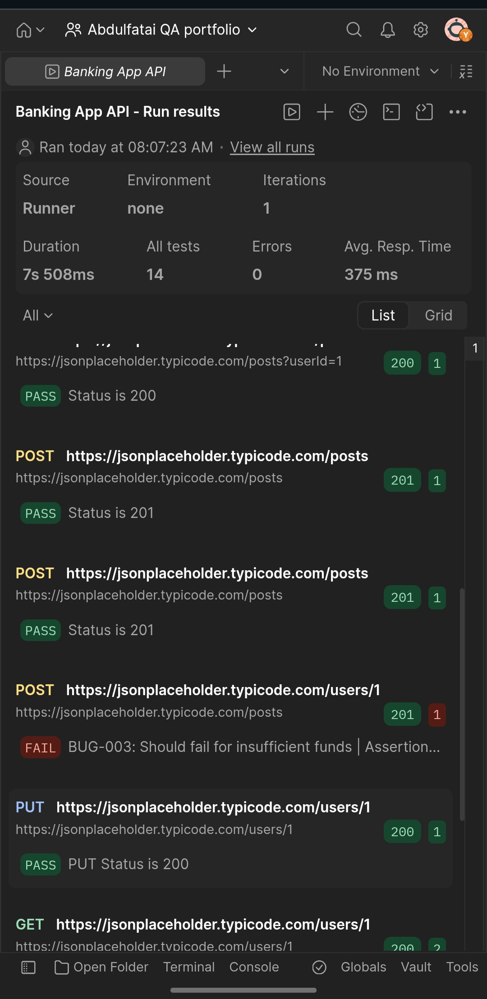
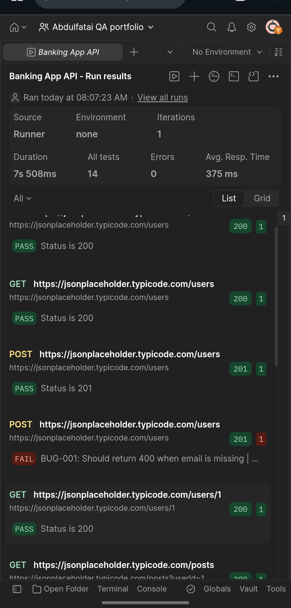

# Banking-App-API-QA
Testing portfolio - Found 2 bugs, 14 tests, Postman

## Overview
Manual API testing for a Banking Application using Postman. Focused on functional testing, negative testing, and validation testing to ensure financial data integrity.

## Tools Used
- Postman / Postman Runner
- JSONPlaceholder as mock Banking API
- GitHub for documentation

## Test Coverage
Total: 11 Test Scenarios | 14 Test Assertions | 12 Passed | 2 Bugs Found

## Execution Result
- Duration: 7s 508ms
- Scenarios: 11, Assertions: 14
- Errors: 0, Avg Response: 375ms

## Bugs Found
BUG-001: Missing email should be 400 but got 201 - Severity High
BUG-003: Insufficient funds should be 400 but got 201 - Severity Critical

## Screenshots

